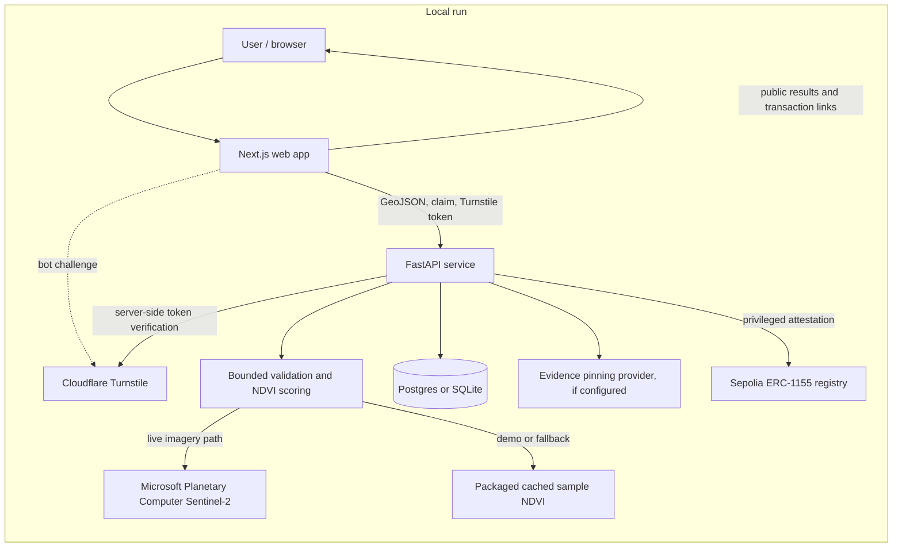
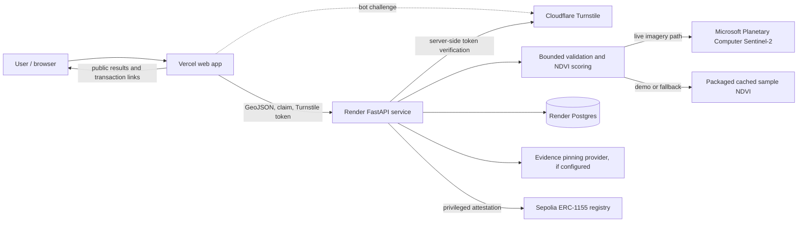

# CarbonLens

AI-scored vegetation evidence plus an on-chain registry that blocks double counting of the same land, running on Sepolia.

**CarbonLens turns vegetation time-series into reviewable, on-chain testnet evidence for transparent carbon-market discussions—not proof of carbon storage.**

## The problem

Carbon-market claims are difficult to compare when their environmental evidence,
methodology, and provenance are not easy to inspect. Satellite vegetation
indicators can help organize evidence, but they do not by themselves establish
carbon sequestration, ownership, additionality, or permanence.

## The solution

CarbonLens accepts a bounded project polygon and claimed area, computes
vegetation, stability, and area-consistency indicators from an NDVI time-series,
and records eligible attestations in a Sepolia ERC-1155 registry. Results expose
their evidence source and limitations so that people can review rather than
over-interpret them.

## How it works



## Optional hosted deployment (not deployed for the hackathon)

The following is a deployment option documented for future use; the hackathon
submission runs locally and does not have a hosted web or API site.



## Demo behavior

The packaged samples use **Cached satellite data**, not live observations:

- **Healthy forest:** cached test series scores 95/100 and is verified in the
  demonstration flow.
- **Deforested sample:** cached test series scores 39/100, including a stability
  score of 0/100 after a sharp NDVI decline, and is rejected.
- **Overlapping sample:** intersects the healthy sample and is reported as a
  duplicate without a second registration.

These illustrative scores are calculated from `data/sample_ndvi.json` with the
scoring model covered by `ai-verifier/tests/test_scoring.py`. The live Sentinel-2 path uses Microsoft Planetary Computer and
can fall back to cached sample data when live retrieval is unavailable. A score
is a vegetation-health indicator; it does not prove carbon storage or credit
quality.

## On-chain evidence

- **Network:** Sepolia (chain ID `11155111`).
- **Registry contract:** [`0x92ba65bF082Ed142A32037ad8cBb21a82E2776A8` on Etherscan](https://sepolia.etherscan.io/address/0x92ba65bF082Ed142A32037ad8cBb21a82E2776A8)
- **Example registration:** [transaction minting 38 ERC-1155 testnet credits for a 40 ha healthy-forest sample at score 95](https://sepolia.etherscan.io/tx/0x9634b36e29dac9e3a71ec882179bba055c6533f65e268854865a3c42b6135b1e)

The credits are testnet demonstration artifacts, not tradable or independently
verified carbon offsets.

## Features

- GeoJSON validation, geometry bounds, overlap checks, and on-chain
  geohash-cell duplicate checks.
- Separate vegetation, stability, and area-consistency components with flags
  and data-source labels.
- Live Sentinel-2 retrieval path through Microsoft Planetary Computer with
  cached fallback, plus explicit cached sample scenarios.
- Server-side Cloudflare Turnstile verification, API rate limiting, and a
  daily registration cap.
- Public API results, evidence hashes, testnet registration transactions, and
  registry statistics.
- Per-request nonce-based Content Security Policy and automated web,
  accessibility, API, contract, and security checks.

## Tech stack

| Area | Technologies |
| --- | --- |
| Web | Next.js, React, TypeScript, Tailwind CSS, Playwright |
| API | FastAPI, Pydantic, SQLAlchemy, PostgreSQL / SQLite |
| Geospatial and imagery | Python, Shapely, Rasterio, PyProj, Sentinel-2 STAC |
| Smart contracts | Solidity, OpenZeppelin ERC-1155, Hardhat, Sepolia |
| Operations and security | Cloudflare Turnstile, Ruff, Bandit, pip-audit, npm audit, Slither, Solhint, Gitleaks |

Vercel and Render are documented as optional hosting platforms; neither was
used to deploy the hackathon submission.

## Track alignment: Carbon Markets & Emissions Transparency

CarbonLens is aligned with the track by making vegetation evidence, scoring
components, data provenance, and testnet attestations easier to inspect. It
explores how structured environmental observations might support more
transparent review of carbon-market claims; it does not calculate stored
carbon or certify projects.

## Judging criteria

| Criterion | What was built |
| --- | --- |
| Climate Impact | An evidence-review workflow using vegetation time-series and clear caveats about the limits of NDVI as a carbon indicator. |
| Innovation & Creativity | A connected geospatial, scoring, duplicate-checking, and testnet-attestation demo. |
| Technical Execution | Bounded API inputs, live imagery retrieval with cached fallback, persistence, ERC-1155 registration, CI, and automated tests. |
| Practical Usefulness | Readable score components, flags, evidence identifiers, source labels, and duplicate/rejection outcomes for review. |
| Presentation & Communication | Public methodology, threat model, responsible-AI notes, API contract, and clear cached-sample/demo limitations. |

## Security and responsible AI

- Security reporting: [SECURITY.md](./SECURITY.md), [threat model](./docs/THREAT_MODEL.md),
  and [security review](./docs/SECURITY_REPORT.md).
- AI use and boundaries: [Responsible AI](./docs/RESPONSIBLE_AI.md).
- Architecture and interfaces: [architecture](./docs/ARCHITECTURE.md) and
  [API reference](./docs/API.md).

The project is aligned with selected security practices and includes automated
scans, but has not received a third-party security audit. The Web dependency
audit currently has unresolved advisories; details are in the security report.

## Limitations

- Sample scenarios use cached NDVI series and are shown as “Cached satellite
  data.” Live Sentinel-2 retrieval is available, with cached fallback.
- NDVI is a vegetation indicator, not a measure of carbon storage, ownership,
  additionality, permanence, or credit quality.
- The verifier is a trusted attestor. Duplicate checks combine on-chain
  geohash cells and off-chain polygon overlap; shifting a claim beyond their
  thresholds may evade detection.
- This is a Sepolia testnet demo using burner testnet keys, not a production
  carbon registry. No third-party audit has been performed.
- The optional [hosted deployment guide](./docs/DEPLOYMENT.md) describes
  free-tier platform limits. No hosted web or API site was deployed for the
  hackathon.
- `npm audit` reports unresolved Web dependency vulnerabilities; see
  [SECURITY_REPORT.md](./docs/SECURITY_REPORT.md).

## Roadmap

- Multi-signature verifier administration.
- Decentralized oracles and more independent observation sources.
- More biomes and region-specific evaluation.
- Zero-knowledge proofs for selective evidence and attestation checks.

## Demo

Demo: watch the video linked on our Devpost submission, or run it locally (instructions below).

## Try it without any keys

From PowerShell at the repository root, run:

```powershell
.\scripts\e2e_demo.ps1
python .\scripts\abuse_tests.py
```

The end-to-end demo starts a temporary local Hardhat chain, so no Sepolia RPC,
wallet, or provider keys are needed. The separate Sepolia evidence is available
in the [linked transaction above](https://sepolia.etherscan.io/tx/0x9634b36e29dac9e3a71ec882179bba055c6533f65e268854865a3c42b6135b1e).

## CI

[](https://github.com/shikhon-rahaman/carbonlens/actions/workflows/web.yml)
[](https://github.com/shikhon-rahaman/carbonlens/actions/workflows/python.yml)
[](https://github.com/shikhon-rahaman/carbonlens/actions/workflows/contracts.yml)
[](https://github.com/shikhon-rahaman/carbonlens/actions/workflows/gitleaks.yml)
[](https://github.com/shikhon-rahaman/carbonlens/actions/workflows/codeql.yml)
[](https://github.com/shikhon-rahaman/carbonlens/actions/workflows/scorecard.yml)
[](https://github.com/shikhon-rahaman/carbonlens/actions/workflows/dependency-review.yml)

## Run locally on Windows

### Prerequisites

- Node.js LTS (the web and contract workflows use Node 20).
- Python 3.11.
- Git and PowerShell.

### Install and configure

From the repository root:

```powershell
py -3.11 -m venv ai-verifier\.venv
.\ai-verifier\.venv\Scripts\python.exe -m pip install --upgrade pip
.\ai-verifier\.venv\Scripts\python.exe -m pip install -r ai-verifier\requirements.txt
.\ai-verifier\.venv\Scripts\python.exe -m pip install -r api\requirements.txt
Copy-Item .env.example .env
Copy-Item .env.example web\.env.local
```

Edit root `.env` for the API's server-side settings. In `web\.env.local`, keep
only the `NEXT_PUBLIC_*` browser settings and set the API base URL, site URL,
contract address, chain ID, explorer base, and Cloudflare site key as needed.
Never place a private key, service token, RPC provider URL containing credentials,
or other secret in `web\.env.local` or any `NEXT_PUBLIC_*` variable. Never commit
`.env` or `web\.env.local`.

For local cached sample scenarios, set `CACHED_DEMO_MODE=true` in root `.env`
and `NEXT_PUBLIC_CACHED_DEMO_MODE=true` in `web\.env.local`. To run without
Cloudflare credentials, `TURNSTILE_DEV_BYPASS=true` is permitted only with
`ENV=development`; it must remain false outside development. Cached mode by
itself never bypasses Turnstile.

### Start the API

Open a PowerShell terminal at the repository root, set development-only values
in root `.env`, then run:

```powershell
.\ai-verifier\.venv\Scripts\python.exe -m uvicorn main:app --app-dir api --host 127.0.0.1 --port 8000
```

### Start the web application

In a second PowerShell terminal:

```powershell
Set-Location web
npm ci
```

For development:

```powershell
npm run dev
```

For a production-mode local build:

```powershell
npm run build
npm run start
```

Open **http://localhost:3000**.

### Run tests

Run Python tests from the repository root:

```powershell
.\ai-verifier\.venv\Scripts\python.exe -m pytest -q ai-verifier\tests
.\ai-verifier\.venv\Scripts\python.exe -m pytest -q api\tests
```

Run web checks from `web`:

```powershell
npm run lint
npm run typecheck
npm run build
npm test
```

Run contract checks from `contracts`:

```powershell
npm ci
npm run compile
npm test
npm run lint
```

Slither is an additional contract analysis step and requires its Python tooling.
