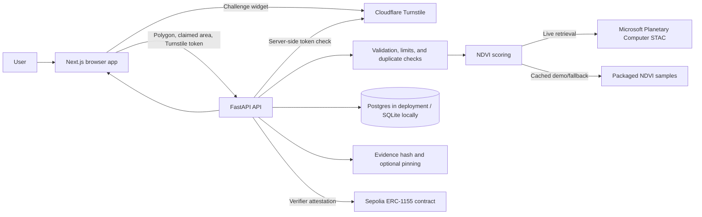

# CarbonLens architecture

CarbonLens is a testnet demo that connects a browser-based project submission
flow to a bounded geospatial API, vegetation time-series scoring, and a
Sepolia ERC-1155 registry. The score is a vegetation-health indicator and does
not prove carbon storage, project ownership, additionality, or permanence.

## Components and data flow

### Web application

The Next.js app collects a project name, claimed hectares, polygon, demo
scenario (when enabled), and Turnstile proof. It displays public project
results and links to evidence/transaction information. Public `NEXT_PUBLIC_*`
configuration is included in the browser bundle; server credentials are not
web configuration.

### API and verifier

The FastAPI service enforces schema and request-size bounds, origin policy,
Turnstile validation, rate limits, and the daily registration cap. It normalizes
geometry, checks duplicates using polygon overlap and registry geohash cells,
and orchestrates scoring, persistence, evidence, and eligible registration.

The verifier has a live Sentinel-2 path through Microsoft Planetary Computer's
STAC API and uses cached fallback data when live data is unavailable. Explicit
sample scenarios use the packaged cached NDVI series and are labeled
**Cached satellite data**. Cached mode does not bypass production bot checks or
rate/registration limits.

### Scoring and evidence

The scoring model reports vegetation, stability, and area-consistency
components, a total, flags, confidence, and source. Time-series observations
and quality limitations affect interpretation. A score is not a carbon
measurement. Evidence is hashed and can be pinned through a configured
provider; public records include evidence identifiers and registration status.

### Registry

The API's verifier account submits eligible attestations to the deployed
Sepolia ERC-1155 contract. The contract records registry claims and testnet
credits. The verifier is a trusted attestor. Duplicate detection combines
on-chain geohash cells with an off-chain overlap check; moving a claim beyond
the applicable thresholds can evade detection. No contract changes are
required for the current hosting setup.

## Deployment topology

- **Web:** Vercel.
- **API:** Render free web service, binding to `0.0.0.0` and Render's `PORT`.
- **Database:** Render Postgres; local development defaults to SQLite.
- **Bot protection:** Cloudflare Turnstile, verified by the API.
- **Registry:** existing Sepolia deployment.

Free Render services can sleep when idle; the first request after inactivity
can take about a minute. See [DEPLOYMENT.md](./DEPLOYMENT.md) for environment
configuration and operational checks.

## Trust boundaries and safeguards

| Boundary | Data crossing it | Safeguards |
| --- | --- | --- |
| Browser → API | User-provided polygon, project metadata, challenge token | Bounded schema, body limits, CORS allow-list, Turnstile, rate limits. |
| API → imagery provider | Constructed spatial/time requests and raster data | Fixed provider endpoints, bounded reads/timeouts, cached fallback. |
| API → database | Validated project and registration state | SQLAlchemy parameterized access; Postgres in deployment. |
| API → blockchain | Signed verifier attestations | Server-side burner testnet key and configured chain/contract checks. |
| API → optional AI provider | Structured scores and sanitized project name | Disabled by default; output is untrusted explanatory text, never scoring or authorization input. |
| Build/deployment → clients | Compiled app and public configuration | CSP, security headers, public-only browser variables, CI scanning. |

For threat analysis, security findings, and AI boundaries, see
[THREAT_MODEL.md](./THREAT_MODEL.md), [SECURITY_REPORT.md](./SECURITY_REPORT.md),
and [RESPONSIBLE_AI.md](./RESPONSIBLE_AI.md).
